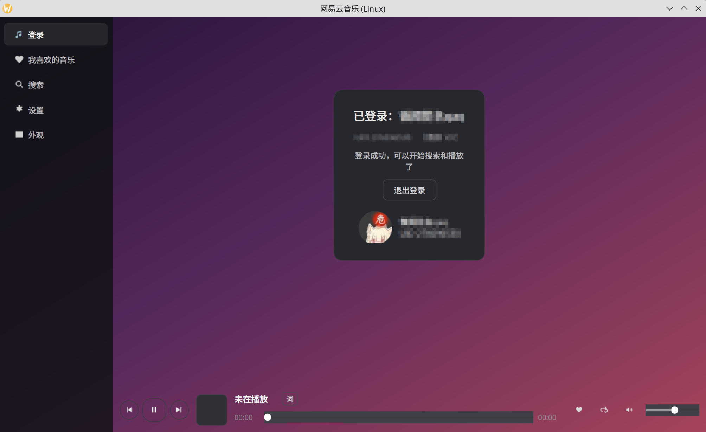
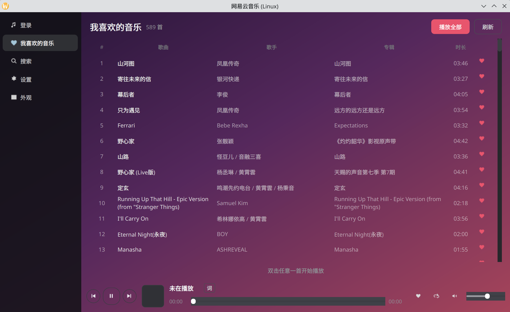
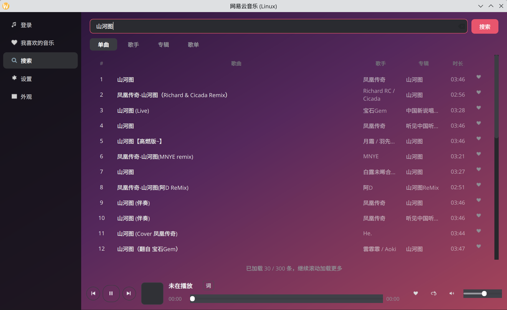
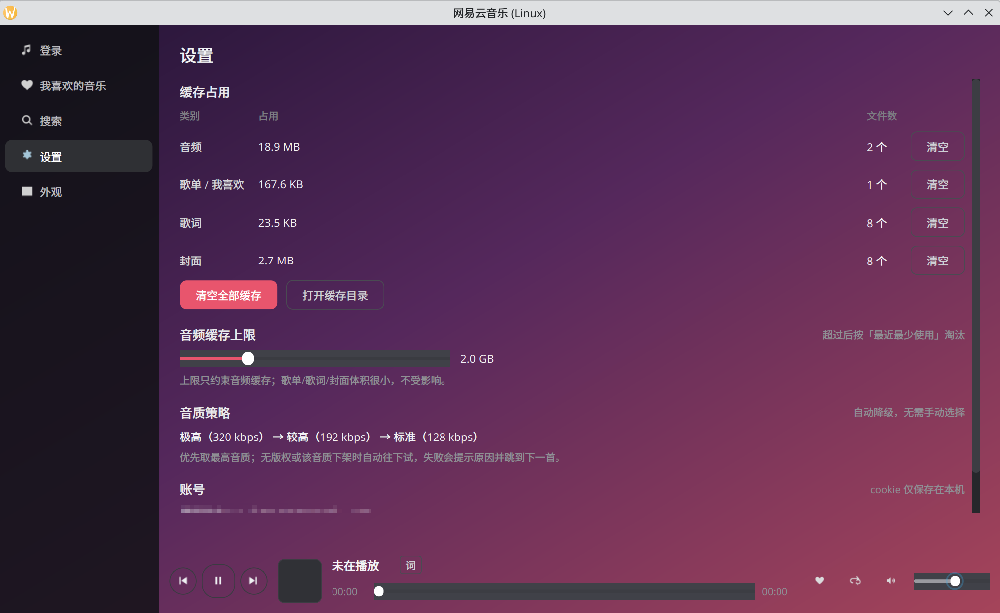
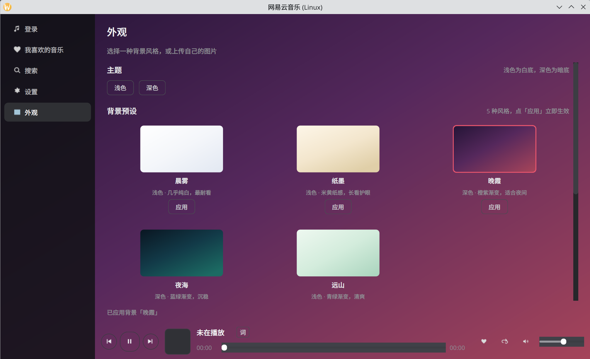

# netease-music-linux

网易云音乐 **Linux 原生桌面客户端**（第三方、非官方）。PySide6 界面 + 系统 mpv 音频后端。

## 功能
- **手机扫码登录**（二维码登录，cookie 本地持久化，重启免扫码）
- **搜索**：单曲 / 歌手 / 专辑 / 歌单 四个 tab，搜索历史，滚动加载更多
- **播放**：播放/暂停、上一首/下一首、进度拖动、音量、四种播放模式（顺序/列表循环/单曲循环/随机）
- **收藏**：一键「加到我喜欢的音乐」，再次点击取消收藏
- **我喜欢的音乐**：完整列表（自动分页拉全）、点播任意一首、顺序播放
- **滚动歌词**：行级高亮 + 翻译副行，平滑滚动居中，手动滚动后自动恢复跟随
- **设置**：四类缓存各自占用与文件数、逐类/全部清理、打开缓存目录、音频缓存上限可调（50 MB~8 GB，超限自动 LRU 淘汰）、音质策略、账号信息与退出登录
- **外观**：浅色/深色主题、5 种背景预设（晨雾/纸墨/晚霞/夜海/远山）、上传自己的图片（按图片亮度自动选主题）、**模糊度可调**（0 用原图，100 最糊）、已上传图片可预览/应用/删除

## 截图

| 登录 | 我喜欢的音乐 |
|---|---|
|  |  |

| 搜索 | 设置 |
|---|---|
|  |  |

| 外观 |
|---|
|  |

## 使用要点
- 搜索页：回车/点「搜索」发起搜索；**双击单曲**直接播放，**双击歌手/专辑/歌单**载入为播放列表；
  行尾 ♥ 收藏/取消收藏；滚动到底自动加载下一页；点输入框可看到搜索历史。
- 播放条：**封面显示当前歌曲的专辑封面**（首次联网下载后落盘缓存），点封面或「词」进歌词页；
  拖动进度条可跳转，右侧切换四种播放模式。
- 设置页：缓存数字在后台线程统计，不会卡界面；「清空全部缓存」会一次性释放全部四类缓存。
- 歌词页：点封面/「词」进入，`← 返回` 回到刚才的页面（播放不中断）；滚轮或拖动可以自己翻看，
  松手 5 秒后自动跟随回当前行。

## 实现进度
| 里程碑 | 状态 |
|---|---|
| M1 骨架 + 扫码登录 | ✅ 已完成（已真机扫码验证） |
| M2 播放内核 + 音频缓存 | ✅ 已完成（端到端实测：能播 / 播完落盘 / 二次命中 / 切歌清理 / 无残留进程） |
| M3 搜索页 | ✅ 代码完成（离线 184 项测试 + 联网 UI 探测 23/23）；👤 听声与观感待人工确认 |
| M4 我喜欢的音乐 | ✅ 已完成（589 首 / 1.3 秒 / 双击点播 / ♥） |
| M4.5 专辑·歌单详情页 | ✅ 已完成（双击进详情、返回、播放全部、点播、♥、当前行高亮） |
| M5 歌词页 + 播放条封面 | ✅ 已完成（真机：封面 14KB 落盘、61 行歌词、位置→行映射、日文歌翻译副行） |
| M6 设置页 / 缓存清理 | ✅ 已完成（真机：四类缓存统计与 du 一致、逐类清理、上限调小立即淘汰、登出链路无报错） |
| M6.5 外观 / 背景 | ✅ 已完成（浅色为默认；5 种预设 + 上传自定义图 + 按亮度自动选主题；真机截图验证） |

## 环境要求
| 依赖 | 版本 | 说明 |
|---|---|---|
| Python | ≥ 3.11 | 本机 3.14 |
| PySide6 | ≥ 6.6 | 系统包或 venv 内安装 |
| requests | ≥ 2.31 | HTTP |
| segno | ≥ 1.6 | 二维码生成（`scripts/setup.sh` 自动装） |
| **mpv** | ≥ 0.35 | 音频后端，需在 PATH 中；Fedora: `sudo dnf install mpv` |

> PyPI 官方源在部分网络环境不可达，安装脚本默认使用阿里云镜像（可用 `PIP_INDEX_URL` 覆盖）。

## 安装与运行
```bash
./run.sh                       # 首次会自动建 venv 并装依赖，然后启动 GUI
# 或者：
scripts/setup.sh               # 只装依赖
scripts/dev.sh                 # 直接跑源码
scripts/dev.sh --offscreen     # 无头冒烟（不显示窗口）
```

## 自检
```bash
scripts/selftest.sh                    # 离线单测 + 文件地图一致性
NET=1 scripts/selftest.sh              # 追加联网只读探测（不写账号数据）
NET_PLAY=1 python tests/integration_probe.py   # 追加 mpv 播放实测
```

## 目录
见 [`AGENTS.md`](./AGENTS.md)（文件地图与改动指引）。需求与验收标准见 [`SPEC.md`](./SPEC.md)。

## 数据与隐私
- 配置、cookie、缓存都在 `~/.config/netease-music-linux/`（cookie 文件权限 `600`）。
- **凭据只保存在本机**，不上传任何第三方服务器；日志不打印 cookie 内容。
- 缓存仅用于本机播放加速，**不提供导出/下载功能**。

## 已知限制
- 仅供个人学习与自用；**非官方客户端**，与网易公司无关。
- 不做 VIP/无损破解：无版权或需要会员的歌曲会明确提示，不会绕过限制。
- 客户端版本更新可能导致接口变化；接口集中在 `src/nemusic/net/endpoints.py`，便于修复。
- 只支持 mpv 可解码的格式（mp3/flac/aac 等常规音频）。
- 歌词只做到**行级**高亮 + 翻译副行，不做逐字（yrc）卡拉OK效果。
- 退出登录会清空本机的收藏列表显示；除此之外**任何情况都不会自动清用户数据**
  （cookie 失效、网络异常、重启恢复失败都只是回到登录页）。
- 背景图只影响外观，不会上传。原图保存在本机配置目录；另外会按当前模糊度
  生成一份同名的 `_blur.jpg` 当底图（关掉模糊就改用原图），删图时一起删。

## 许可
MIT（仅覆盖本项目代码；不含任何第三方商标或资源）。
